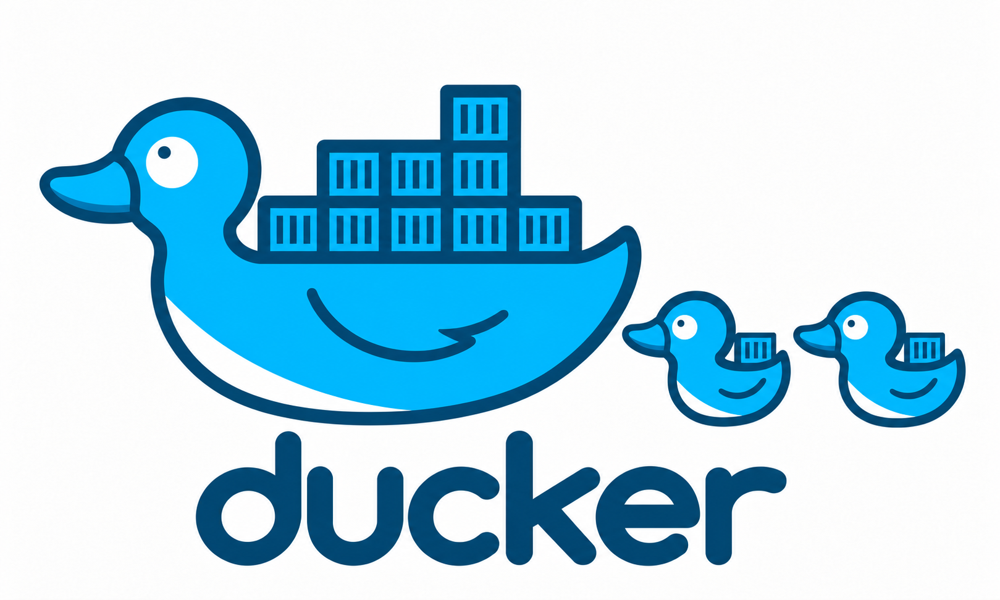

<div align="center">
  

  <h3>A toy container runtime, written in Go, for learning how Docker actually works</h3>

  <p>
    
    
    
    
  </p>
</div>

---

**ducker** is a tiny, educational re-implementation of the core ideas behind Docker:
namespaces, cgroups, and chroot, stitched together in a few hundred lines of Go.
It's not trying to replace Docker — it's trying to show you exactly what Docker
is doing under the hood, with nothing hidden.

> [!WARNING]
> This is a learning project, not a production container runtime. It uses
> `chroot` instead of `pivot_root`, has no image registry, and skips most of
> the security hardening a real runtime needs. Don't run untrusted workloads
> with it.

## How it works

`ducker run` re-execs itself as `ducker child` inside a fresh set of Linux
namespaces, then jails and launches your process:

```
ducker run <rootfs> <cmd>
        │
        ▼
 ┌─────────────────────────────┐
 │ clone() with new namespaces │  UTS · PID · mount · net · IPC
 └──────────────┬──────────────┘
                ▼
 ┌─────────────────────────────┐
 │ ducker child                │
 │  1. sethostname("ducker")   │
 │  2. apply cgroup limits     │  memory, pids
 │  3. chroot(rootfs)          │
 │  4. mount /proc             │
 │  5. exec(cmd)                │
 └─────────────────────────────┘
```

## Getting started

Containers are a Linux kernel feature, so ducker only runs on Linux. On
macOS/Windows, use a Linux VM (Lima, Vagrant, UTM, etc.) to build and run it.

```sh
git clone https://github.com/emreuygun/ducker.git
cd ducker
make build
```

Point it at any extracted root filesystem (an Alpine or BusyBox rootfs
works great for testing) and a command to run inside it:

```sh
sudo ./bin/ducker run /tmp/alpine-rootfs /bin/sh
```

You're now in a shell with its own hostname, process tree, and mount
namespace — a real, if minimal, container.

## Project layout

```
cmd/ducker/           CLI entrypoint (run / child subcommands)
internal/container/   namespace setup, chroot, process exec
internal/cgroups/     memory & pids limits via cgroups v1
```

## Roadmap

- [x] Namespaces (UTS, PID, mount, net, IPC)
- [x] Basic cgroup limits (memory, pids)
- [x] chroot-based filesystem isolation
- [ ] `pivot_root` instead of `chroot`
- [ ] Image layers + overlayfs
- [ ] Pulling images from a registry
- [ ] Container networking (veth + bridge)
- [ ] `ducker build` from a Dockerfile-like spec

## Contributing

This is a personal learning project, but issues and PRs that improve the
teaching value of the code are welcome.

## License

MIT
